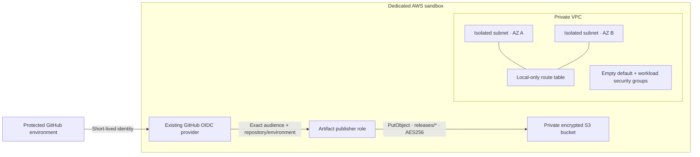

# AWS Terraform Guardrails

A small, testable AWS foundation from **Laniakea Consult**: isolated networking
and a GitHub publishing role whose access can be reviewed in a few files.

Teams often inherit wide-open outbound rules, long-lived CI credentials, and
cloud roles that can change far more than a deployment requires. This lab shows
how to constrain those defaults and test the intended boundary before using
an AWS account.

**Verified locally:** Terraform validation and **17 mocked plan tests** pass.
**Deployment status:** no AWS resources were provisioned; IAM and network
behavior have not been tested against a live account. See [recorded evidence](evidence/README.md).

## What is here

| Control | Implementation | Verified by |
|---|---|---|
| Bounded private networking | Canonical RFC1918 `/16`–`/24` VPC, two nonoverlapping derived subnets in distinct AZs | CIDR rejection and boundary tests |
| Explicit isolation | No public IP assignment or internet/NAT gateway; subnet route table has only the AWS local route | Subnet and configured-route assertions |
| Minimal traffic permissions | Empty default and workload security-group rules | Ingress and egress assertions |
| Protected artifacts | S3 public access blocked, ACLs disabled, SSE-S3 encryption, versioning, TLS-only policy | Storage configuration assertions |
| Narrow GitHub trust | Exact `aud` plus exact repository/environment `sub`; immutable IDs supported | Trust document and invalid-input tests |
| Small publishing permission | List only `releases/*`; put only encrypted objects there | Exact IAM actions, resources and conditions |



The identity/storage path is independent of the VPC. GitHub-hosted runners
reach S3 through its public service endpoint with IAM and TLS. The VPC contains
no workload, endpoint, internet egress, or application traffic rules. The publisher
role cannot provision this Terraform configuration.

## Quickstart: no AWS account needed

Install [Terraform 1.16.1](https://developer.hashicorp.com/terraform/install)
and run from this repository's root:

```sh
git clone https://github.com/nayabsaiyed/aws-terraform-guardrails.git
cd aws-terraform-guardrails
terraform fmt -check -recursive
terraform init -backend=false -input=false -lockfile=readonly
terraform validate -no-color
terraform test -no-color
```

Initialization downloads the official, locked AWS provider. Every test uses
`mock_provider "aws"` and `command = plan`, so the tests need no AWS credentials
and create no cloud resources. Expected result: `Success! 17 passed, 0 failed.`
Do not substitute a plain `terraform plan` for `terraform test`; a real plan
uses the configured AWS provider and requires an account context.

The [GitHub Actions workflow](.github/workflows/validate.yml) runs these same
checks with read-only repository permission and SHA-pinned actions. It has no
cloud credentials, OIDC token permission, deployment job, or automatic apply.
Provider and action updates are proposed through Dependabot for review.

## Inspect or adapt it

- [variables.tf](variables.tf) defines allowed inputs and their limits.
- [network.tf](network.tf) owns the new VPC, subnets, route table and groups.
- [storage.tf](storage.tf) configures the artifact bucket.
- [identity.tf](identity.tf) contains the complete trust and publishing policies.
- [tests/](tests/) contains the assertions and expected rejection cases.
- [terraform.tfvars.example](terraform.tfvars.example) contains synthetic values
  for a separately approved sandbox deployment.

The GitHub subject format matters. New GitHub.com repositories created after
July 15, 2026, and opted-in existing repositories include immutable owner and
repository IDs. Set both IDs to generate
`repo:OWNER@OWNER_ID/REPO@REPO_ID:environment:ENVIRONMENT`. Only omit both for a
repository verified to use the classic subject. A protected environment must
also restrict which branches/tags may deploy; the environment subject itself
does not impose a branch restriction. [GitHub OIDC documentation](https://docs.github.com/en/actions/reference/security/oidc)

The wildcard in the S3 **deny** policy denies insecure requests to all objects;
it does not grant broad access. The publisher's only wildcard selects objects
inside one `releases/` prefix. It cannot read/delete objects or administer AWS.
It can publish a new version of an existing release key; versioning is not
immutability or a complete retention policy.

## Before deploying

Follow the [operator runbook](docs/runbook.md) for account verification, the
existing OIDC provider, GitHub environment protection, state handling, manual
plan review, live validation, and cleanup. Nothing in this repository has been
applied to AWS.

Production adoption needs additional decisions: application routes/rules,
flow logs and monitoring, retention, customer-managed keys where required,
remote state, account guardrails, and live IAM negative tests. The mocked suite
checks Terraform configuration, not the AWS authorization engine or data plane.
A later policy attachment can broaden this role; this example does not impose
an IAM permissions boundary.

Mocked validation creates no AWS charges. A real deployment and uploads can
incur S3 storage, request, transfer, and retained-version costs. This example
creates no NAT gateway, public IPv4 address, or compute. Review current
[S3 pricing](https://aws.amazon.com/s3/pricing/) before sandbox use.

## Work with Laniakea

Laniakea Consult helps teams review AWS delivery permissions, Terraform changes,
and infrastructure reliability. If you need a focused review of your own
deployment path, [contact Laniakea](https://laniakeaconsult.com/contact?service=devops)
or email [nayab@laniakeaconsult.com](mailto:nayab@laniakeaconsult.com).

This is original demonstration code, not a client environment or a claim of
production results. [MIT licensed](LICENSE); upstream tools retain their own
licenses. [Security reporting](SECURITY.md).
